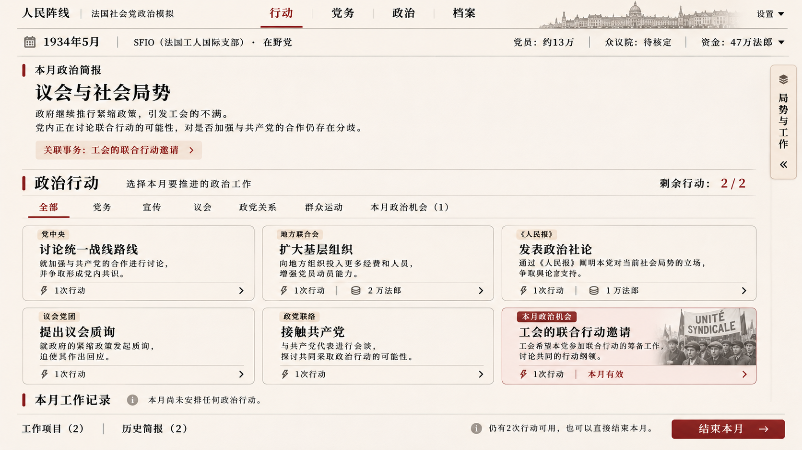

# 人民阵线 · Front populaire

法国第三共和国人民阵线时期的社会党政治模拟。1934年1月—1938年12月，玩家代表法国工人国际支部（SFIO）中央领导层，围绕党内政治、联盟、议会、群众运动、两轮选举及执政实践展开决策。

**项目状态（2026-11-26）：Phase 0.5C，UI01、UI02及UI03-01、UI03-02主页面与A/B/C详情、UI03-03主页面与A/B详情、UI03-04主页面已暂定通过且归档；UI03-04-A地方联合会详情第三版视觉已暂定通过，原始PNG尚待上传，其他地方子交互尚待细化。尚未进入游戏代码开发。**

## 项目文档
| 文档 | 内容 |
|---|---|
| [PROJECT_ROADMAP](docs/PROJECT_ROADMAP.md) | 阶段规划与验收边界 |
| [GAME_DESIGN](docs/GAME_DESIGN.md) | 游戏设计理念与核心体验 |
| [SIMULATION_SPEC](docs/SIMULATION_SPEC.md) | 已同意机制边界及未决规则 |
| [HISTORICAL_MODEL](docs/HISTORICAL_MODEL.md) | 历史证据与模拟参数转换纪律 |
| [DECISION_LOG](docs/DECISION_LOG.md) | 已确认、替代及暂定决策 |
| [OPEN_ISSUES](docs/OPEN_ISSUES.md) | 历史、机制、UI及实现遗留事项 |

## 历史资料
- [Phase 0 v0.6 解包底库](research/phase0-v06/)：47张CSV、2份Markdown、1份JSON；180项来源，30个专题，2,823条CSV记录。
- [原始ZIP](research/archives/front_populaire_phase0_v06.zip)。
- [研究交接](research/phase0-v06/PHASE0_HANDOFF.md) · [审计](research/phase0-v06/audit.json)。

状态 **CLOSED_WITH_GAPS**：允许阶段移交，非全部原档获取或全面准确性验收。保留原始口径、缺值及冲突。

## UI 设计
- [通用视觉规范](design/UI_DESIGN_SYSTEM.md) · [UI01](design/UI01_SPEC.md) · [UI02](design/UI02_SPEC.md) · [UI03](design/UI03_SPEC.md) · [后续规划](design/UI_ROADMAP.md)。
- [十九张已归档效果图](design/mockups/)；UI03-04最终稿原始PNG已归档。UI03-04-A视觉已暂定通过，原始PNG待上传至 `design/mockups/ui03-04-a-local-federation-detail.png`，入库核验前不计入已归档数量。

### 当前主要视觉基准

| 视觉参考 | 状态 |
|---|---|
| [UI01-02 重大危机](design/mockups/ui01-02-crisis.png) | 暂定通过 |
| [UI01-03 已安排行动](design/mockups/ui01-03-queued.png) | 暂定通过 |
| [UI01-04 抽屉展开](design/mockups/ui01-04-drawer.png) | 暂定通过 |
| [UI02-01 主动行动](design/mockups/ui02-01-action-detail.png) | 暂定通过 |
| [UI02-02 重大事件](design/mockups/ui02-02-required-event.png) | 暂定通过 |
| [UI02-03 行动结果](design/mockups/ui02-03-result.png) | 暂定通过 |
| [UI02-04-A 新建项目](design/mockups/ui02-04-a-new-project.png) | 暂定通过 |
| [UI02-04-B 项目管理](design/mockups/ui02-04-b-project-management.png) | 暂定通过 |
| [UI02-05 条件不足](design/mockups/ui02-05-prerequisites.png) | 暂定通过 |
| [UI03-01 党务总览](design/mockups/ui03-01-party-overview.png) | 暂定通过 |
| [UI03-02 党中央](design/mockups/ui03-02-central-committee.png) | 暂定通过 |
| [UI03-02-A CAP构成](design/mockups/ui03-02-a-cap-composition.png) | 暂定通过 |
| [UI03-02-B 决议与授权](design/mockups/ui03-02-b-resolution.png) | 暂定通过 |
| [UI03-02-C 动议审议](design/mockups/ui03-02-c-motion-review.png) | 暂定通过 |
| [UI03-03 党内派系](design/mockups/ui03-03-party-factions.png) | 暂定通过 |
| [UI03-03-A 政治团体详情（方案B）](design/mockups/ui03-03-a-faction-detail.png) | 暂定通过 |
| [UI03-03-B 具体议题各方立场](design/mockups/ui03-03-b-issue-positions.png) | 暂定通过 |
| [UI03-04 地方联合会](design/mockups/ui03-04-local-federations.png) | 暂定通过；原始PNG已归档 |
| UI03-04-A 地方联合会详情 | 第三版视觉暂定通过；PNG待上传，尚无仓库图片链接 |

效果图为视觉参考，不是实现规格、历史照片或正式数值。文字规范与图稿冲突时，以已确认决策及文字规范为准；未定机制留待后续确认。

## 设计边界
每月两次主动行动；仅行动机会与党资金两种通用资源；四项经济状态；不设独立经济与地理经营，保留后台抽象选区和两轮退选协商；内阁职位遵循史实。坚持先形成视觉设计再开发。
